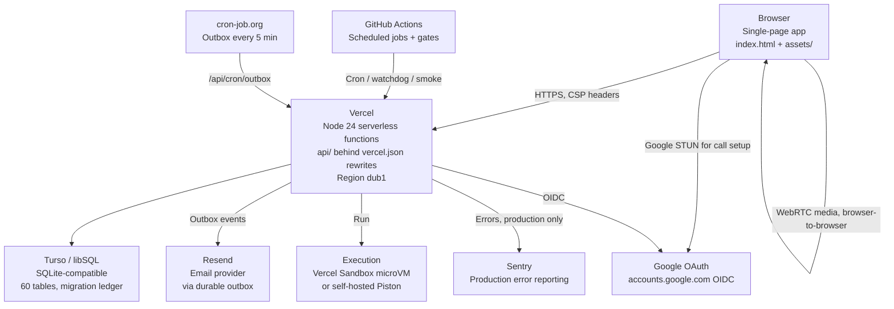
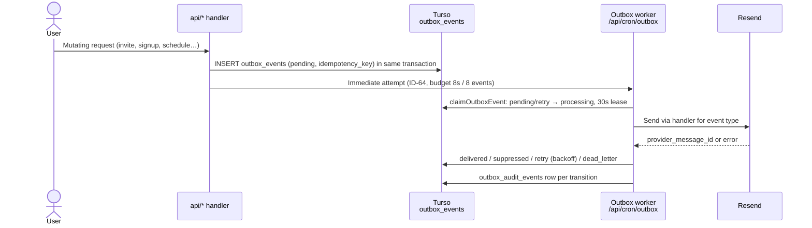
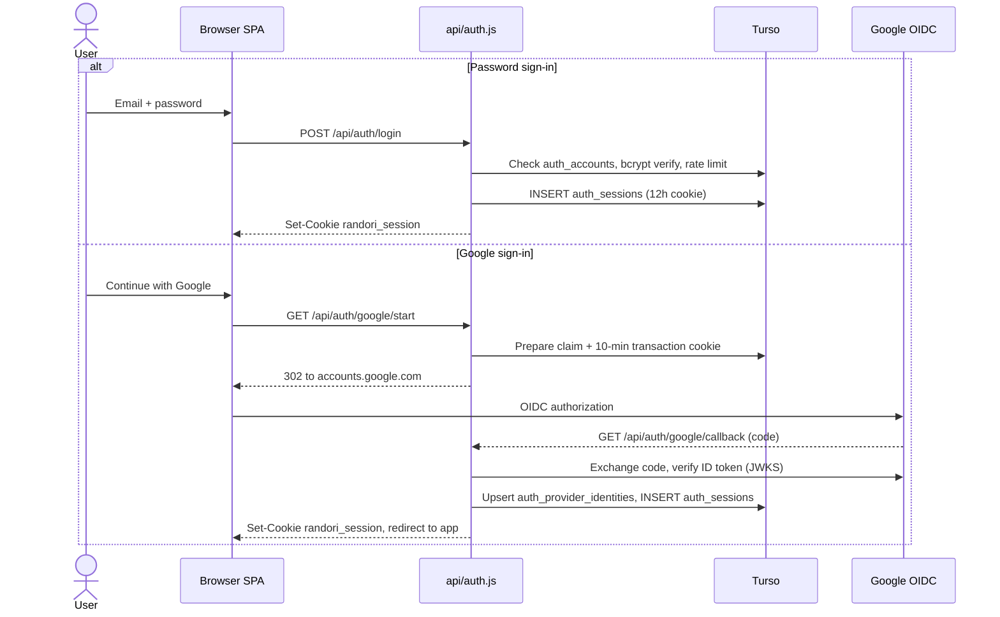
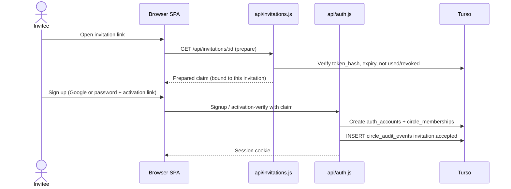
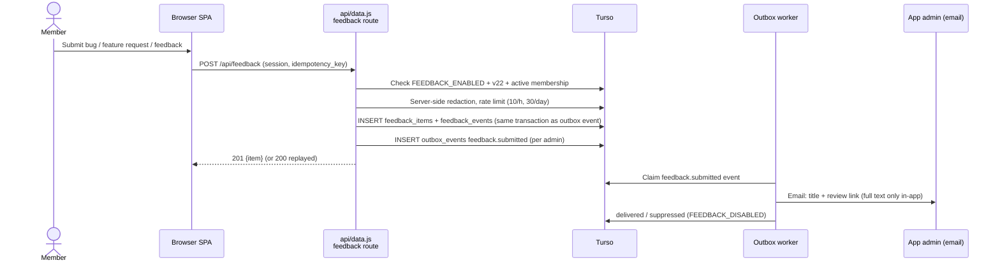
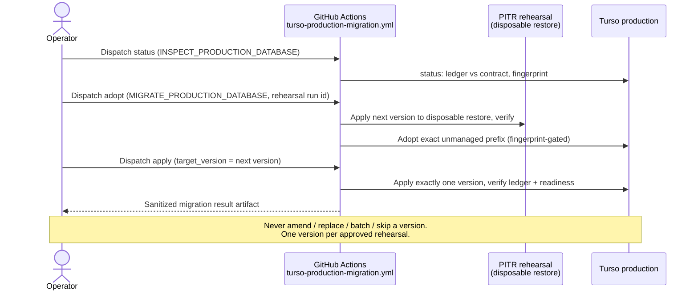

# Randori Circle — current system design

Status: current runtime. Every claim in this document was checked against the
code and configuration on `main` at the time of writing; the
[spot-check appendix](#appendix-spot-checks) lists the evidence for the
load-bearing claims. Where this document and an older doc disagree, this
document wins for the current runtime; the older doc is marked historical
where it is known to be out of date.

This document mints no decision-log ID and carries no landing date: entries
in this repo's decision log carry no landing date, and this is docs work
following the docs-hygiene precedent.

For the authoritative detail behind any section below, follow the link to
the dedicated doc. For every accepted product, security and operations
decision, see the [decision log](IMPLEMENTED_DECISIONS.md). For every
environment variable and the production state of every flag, see
[ENVIRONMENT.md](ENVIRONMENT.md). For the docs index, see
[README.md](README.md) in this directory.

## 1. Overview

Randori Circle is a private, invite-only app for peer mock interviews.
Members of a small circle say each week whether they are available. Every
Sunday they get a fair, repeat-aware pairing. Partners agree a time, then
meet in a private pair room to practise original JavaScript and Python
exercises together.

Production is <https://randoricircle.com>. `www.randoricircle.com`
redirects there permanently; the old `randori-circle-self.vercel.app`
alias redirects its pages (not `/api/*`) temporarily.



What this system is *not*: the proposed Next.js / PostgreSQL / Supabase /
Liveblocks / LiveKit end state in
[PRODUCTION_ARCHITECTURE_PLAN.md](PRODUCTION_ARCHITECTURE_PLAN.md) is a
historical proposal, not the runtime. Nothing in this document describes
that target as current.

## 2. Components

| Component | What it is | Evidence |
| --- | --- | --- |
| Static SPA | One `index.html` page plus `assets/*.js` / `*.css`, no build step except the checked-in CRDT editor bundle (`npm run build:crdt`). Static pages `privacy.html`, `terms.html`. | `README.md` "How it is built"; `package.json` `build:crdt` |
| API | Node.js 24 serverless functions in `api/` on Vercel, grouped behind rewrites in `vercel.json`. Files starting with `_` are shared helpers, not routes. | `vercel.json`; `package.json` engines `node 24.x` |
| Database | Turso (libSQL / SQLite-compatible) via `@libsql/client`. Schema changes only through the append-only migration ledger in `db/`. Request paths never run DDL; CI enforces that. | `api/_db.js`; `db/migration-contract.js` |
| Email | Resend, through one durable, idempotent outbox (`outbox_events`). | `api/_outbox.js`; `api/_outbox-delivery.js` |
| Auth | Session cookies, Google OIDC, invitation-bound password signup with activation, password reset, recent-auth step-up. | `api/auth.js`; `api/_google-oidc.js` |
| Pairing / scheduling | Weekly pairing publication, explicit availability, pair schedules, meeting links, session controls, completion receipts. | `api/ops.js`; `api/_pairing-*.js` |
| Execution sandbox | Vercel Sandbox microVM or a self-hosted Piston-compatible endpoint, selected by `EXECUTION_PROVIDER`. | `api/_execution.js` |
| Feedback platform | Product feedback from members (bug / feature request / general), behind `FEEDBACK_ENABLED`, migration v22. Distinct from AI coaching feedback (`ai_feedback`). | `docs/FEEDBACK.md`; `api/_feedback-api.js` |
| AI coaching | Consent-gated AI feedback in `api/ai.js`. Off in production (`AI_ENABLED` off). | `api/ai.js`; `docs/ENVIRONMENT.md` |
| Export | Private `.ics` calendar export, generated in the browser from an accepted session. No server-side export endpoint. | `assets/calendar-export.js` |
| Observability | Sentry (production only), client/server `app_logs`, admin Diagnostics. | `api/_sentry.js`; `api/_admin-diagnostics.js` |
| Schedulers | Vercel cron (weekly pairing only), GitHub Actions (watchdogs, smoke, backup rehearsal), cron-job.org (outbox). | `vercel.json` crons; `.github/workflows/` |
| Local runtime | `npm run dev` serves the real handlers on loopback with a local SQLite file, seeded owner + circle, email captured locally, Run unavailable. | `scripts/local-server.mjs`; `README.md` |

### 2.1 API functions

Public paths are rewritten in `vercel.json` to a handler plus an
`?endpoint=` query. The catch-all rewrite at the end of `vercel.json`
sends every other path to `/` (the SPA).

| Handler | Serves (rewritten public paths) |
| --- | --- |
| `api/auth.js` | `/api/auth/*`: capabilities, signup, activation resend/verify, password-reset request/consume, recent-auth, identities, identity-password, identity-google-unlink, login, me, logout, logout-all, account/delete, Google start / reauth start / link start / callback |
| `api/data.js` | `/api/circle`, `/api/weeks`, `/api/history`, `/api/progress`, `/api/init`, `/api/profile`, `/api/my-pair`, `/api/pair-recap`, `/api/exercise-suggestions`, `/api/session-completion`, `/api/session-controls`, `/api/meeting-link`, `/api/stats`, `/api/schedule`, `/api/messages`, `/api/questions`, `/api/runs`, `/api/leetcode`, `/api/leetcode/sync`, `/api/execute`, `/api/logs`, `/api/health*`, `/api/feedback`, `/api/feedback/mine` |
| `api/ops.js` | `/api/circle/health`, `/api/settings/availability`, `/api/pairing/run`, `/api/admin/reshuffle`, `/api/cron/weekly`, `/api/cron/outbox-health`, `/api/cron/execution-smoke`, `/api/cron/outbox`, `/api/admin/outbox/replay`, `/api/admin/diagnostics`, `/api/admin/demo-*`, `/api/notifications/prefs` |
| `api/invitations.js` | `/api/invitations/prepare`, `/api/invite-requests`, `/api/invite-requests/decision`, `/api/invitations/:id` (create / list / accept / revoke invitations; invite-request intake and owner decision) |
| `api/members.js` | `/api/members` (owner roster) |
| `api/circles.js` | Circle create / select / archive (multi-circle control plane; off in production) |
| `api/video.js` | `/api/video/signal`, `/api/video/ice`, `/api/video/join`, `/api/video/leave` |
| `api/ai.js` | `/api/ai/analyze`, `/api/ai/feedback`, `/api/ai/feedback/:id`, `/api/ai/history` (off in production) |
| `api/code-document.js` | Shared Yjs code documents for a pair room |

Shared helpers (`api/_*.js`) are never routes. The authorization helpers
that matter most are §5: `_pair-access.js`, `_active-circle.js`,
`_member-lifecycle.js`.

### 2.2 The SPA

`index.html` is a single page; its `assets/` modules cover the shell,
auth dialog, landing, onboarding, pairing view, room layout, circle UI,
home dashboard, progress view, admin diagnostics, account deletion,
bulk invite, calendar export, catalogue view, exercise suggestions,
feedback-adjacent views, and the CRDT editor bundle. There is no
framework build: the only generated file is the checked-in
`assets/crdt-editor.js` bundle produced by `npm run build:crdt` from
`assets/crdt-editor-source.js`, and CI verifies the bundle matches its
pinned sources.

## 3. Request lifecycle

### 3.1 Routing, rewrites and redirects

1. Vercel applies `vercel.json` in order: redirects, headers, then
   rewrites.
2. `www.randoricircle.com` → `https://randoricircle.com/:path`,
   permanent. `randori-circle-self.vercel.app` → canonical origin,
   temporary, for non-`/api/*` paths only; `/api/*` still serves from
   the alias.
3. `/api/*` rewrites map a stable public path to a handler plus
   `?endpoint=…` (table in §2.1). The final catch-all rewrite sends
   everything else to `/`.
4. `/api/*` responses carry `Cache-Control: no-store` and
   `X-Content-Type-Options: nosniff`. All responses carry the security
   headers in §7.

### 3.2 Security headers

From `vercel.json`, applied to `/(.*)`:

- `Content-Security-Policy`: `default-src 'self'; base-uri 'self';
  object-src 'none'; frame-ancestors 'none'; form-action 'self'
  https://accounts.google.com;` with `script-src` / `style-src` /
  `font-src` allowing `'self'`, `'unsafe-inline'` (and `'unsafe-eval'`
  for scripts) plus `js-de.sentry-cdn.com`, `cdnjs.cloudflare.com`,
  `unpkg.com`, `cdn.jsdelivr.net`; `img-src 'self' data: blob:`;
  `media-src 'self' blob:`; `worker-src 'self' blob:`; `connect-src
  'self' https://*.sentry.io https://*.ingest.sentry.io
  https://in.logtail.com`; `upgrade-insecure-requests`.
- `Referrer-Policy: no-referrer`
- `Permissions-Policy: camera=(self), microphone=(self),
  geolocation=()`
- `Strict-Transport-Security: max-age=31536000; includeSubDomains`
- `X-Content-Type-Options: nosniff`, `X-Frame-Options: DENY`,
  `Cross-Origin-Opener-Policy: same-origin-allow-popups`.

### 3.3 Auth

- **Sessions.** On sign-in the server creates a row in `auth_sessions`
  keyed by a 64-hex-char SHA-256 session hash and sets cookie
  `randori_session`: `HttpOnly; SameSite=Lax; Max-Age=43200` (12 hours),
  `Secure` on HTTPS. Revocation reasons are `current_logout`,
  `logout_all`, `password_change`, `identity_change`,
  `membership_removed`, `rotation`. `POST /api/auth/logout-all`
  revokes every session for the account.
- **Password.** Invitation-bound signup only: an account is created in
  the tab that prepared a live invitation; activation is a verification
  link (`auth_email_activations`, token hash, 5-send cap). Password
  login and "Forgot password?" (`auth_password_resets`) are behind
  their flags. Password hashes use bcrypt (`bcryptjs`).
- **Google OIDC.** Authorization endpoint
  `https://accounts.google.com/o/oauth2/v2/auth`, token endpoint
  `https://oauth2.googleapis.com/token`, JWKS
  `https://www.googleapis.com/oauth2/v3/certs`, issuer
  `https://accounts.google.com`. Identity is bound to a
  `auth_provider_identities` row (`issuer`, `subject`, `user_id`).
  The OAuth transaction cookie lives 10 minutes
  (`OAUTH_TRANSACTION_TTL_SECONDS = 10*60`).
- **Recent auth.** Sensitive lifecycle actions (ownership transfer,
  co-owner / app-admin changes, deactivating another owner, account
  deletion) require authentication within the last 10 minutes
  (`RECENT_AUTH_MAX_AGE_SECONDS = 10*60`), by password or Google
  re-auth. See [LIFECYCLE_RECENT_AUTH.md](LIFECYCLE_RECENT_AUTH.md).
- **Capabilities.** `GET /api/auth/capabilities` advertises what is
  actually on (e.g. `verified_invite`, `verifiedEmailActivation`,
  `passwordReset`, `identityManagement`, `inviteRequests`,
  `circleHealth`, `adminDiagnostics`, `accountDeletion`) so the UI
  never advertises more than the server offers.
- **Rate limits.** `auth_rate_limits` keys attempts per operation;
  feedback has its own limits (§6.4).

### 3.4 Active-circle context

With the multi-circle flags off in production, every private route
operates on the single primary circle. When
`MULTI_CIRCLE_CONTROL_PLANE_ENABLED` is on, a session carries a
circle context (`auth_session_circle_contexts`, at most
`MAX_CIRCLES_PER_ACCOUNT = 100` circles per account) and routes
validate that context before touching circle-scoped data. See
[ACTIVE_CIRCLE_CONTEXT.md](ACTIVE_CIRCLE_CONTEXT.md).

### 3.5 Authorization patterns

- **`_pair-access.js`.** Pair-owned reads and writes repeat one
  authorization predicate in the storage statement itself (a reusable
  CTE / join): the caller must be a participant of that
  `(week_id, pair_group_id)` — `user_a_id`, `user_b_id` or `user_c_id`
  — and, when `CIRCLE_MEMBERSHIP_ENABLED`, an active member of the
  non-archived primary circle. Authorization is re-checked in the
  statement rather than trusted from an earlier preflight, so it
  cannot race a membership change.
- **`_active-circle.js`.** Validates the session's active-circle
  context, the flag chain
  (`CIRCLE_MEMBERSHIP_ENABLED` →
  `MULTI_CIRCLE_CONTROL_PLANE_ENABLED` →
  `MULTI_CIRCLE_AVAILABILITY_ENABLED` → secondary flags), and
  refuses cross-circle access.
- **`_member-lifecycle.js`.** Owner-only roster reads and lifecycle
  mutations (leave, deactivate, reactivate, ownership transfer,
  co-owners, app admins). Roster reads require an active `owner` row
  for that circle; pagination is cursor-based
  (`MEMBER_PAGE_DEFAULT = 50`, `MEMBER_PAGE_MAX = 100`,
  `MEMBER_SCAN_LIMIT = 200`). See
  [MEMBER_LIFECYCLE.md](MEMBER_LIFECYCLE.md).
- **Admin.** App admins (`ADMIN_EMAILS`, or `is_admin` on the account)
  get the read-only Diagnostics view; they do not get write access
  through it.

## 4. Data model

### 4.1 ERD (main tables)

```mermaid
erDiagram
    auth_accounts ||--o{ circle_memberships : has
    circles ||--o{ circle_memberships : has
    circles ||--o{ circle_invitations : has
    circles ||--o{ invite_requests : has
    circles ||--o{ feedback_items : has
    auth_accounts ||--o{ auth_sessions : has
    auth_accounts ||--o{ auth_provider_identities : has
    auth_accounts ||--o{ auth_email_activations : has
    auth_accounts ||--o{ auth_password_resets : has
    pairing_weeks ||--o{ pairing_groups : has
    pairing_groups ||--o{ pairing_participants : has
    pairing_groups ||--o{ pair_schedules : has
    pairing_groups ||--o{ pair_messages : has
    pairing_groups ||--o{ pair_code_documents : has
    pairing_groups ||--o{ pair_session_controls : has
    pairing_groups ||--o{ pair_meeting_links : has
    pairing_groups ||--o{ session_completion_receipts : has
    pairing_cycles ||--o{ pairing_cycle_availability : has
    circles ||--o{ pairing_cycles : scopes
    circles ||--o{ circle_pairing_publications : has
    circle_pairing_publications ||--o{ circle_pairing_groups : has
    auth_accounts ||--o{ session_runs : has
    auth_accounts ||--o{ ai_consents : has
    ai_sessions ||--o{ ai_feedback : has
    outbox_events ||--o{ outbox_audit_events : has
    feedback_items ||--o{ feedback_votes : has
    feedback_items ||--o{ feedback_events : has
    auth_accounts ||--o{ app_logs : writes
    auth_accounts ||--o{ feedback_items : authors
```



### 4.2 Tables by domain

The schema manifest on `main` defines **60 tables, 77 named indexes
and 26 triggers** (`db/schema-manifest.js`; tolerated legacy tables
`ai_monthly_usage`, `schema_migrations` are not counted). Key columns
below are the ones routes and runbooks depend on; the manifest is the
complete definition.

| Domain | Tables |
| --- | --- |
| Accounts | `auth_accounts` (email unique, `password_hash`, `display_name`, `color`, `is_admin`, `is_demo`, `google_sub`), `auth_provider_identities` (issuer `https://accounts.google.com` + subject), `auth_sessions`, `auth_email_activations`, `auth_password_resets`, `auth_recent_proofs`, `auth_provider_email_state`, `auth_identity_audit_events`, `auth_rate_limits`, `auth_session_circle_contexts` |
| Circles and memberships | `circles` (one non-archived primary, `uq_circles_active_primary`), `circle_memberships` (role `owner`/`member`, status `active`/`inactive`), `circle_invitations` (`token_hash`, `email_hash`, both 64-hex SHA-256), `circle_audit_events`, `circle_membership_rollout` (singleton id 1), `circle_creation_requests` |
| Invitations / requests | `circle_invitations`, `invite_requests` (pending → approved/declined/expired; personal fields nulled on decision) |
| Pairing | `pairing_weeks`, `pairing_groups` (a/b/c members), `pairing_participants`, `pairing_week_runs`, `pairing_email_outbox` (legacy pairing mail), `pairing_cycles`, `pairing_cycle_availability`, `circle_pairing_publications`, `circle_pairing_eligibility`, `circle_pairing_groups` |
| Scheduling | `pair_schedules` (proposals + agreed time), `circle_pair_schedules`, `circle_pair_schedule_proposals`, `pair_meeting_links` |
| Sessions / runs | `pair_messages` (chat), `pair_room_snapshots`, `pair_code_documents` (Yjs state), `pair_session_controls` (focus timer + candidate), `session_completion_receipts`, `session_runs`, `questions`, `custom_questions` |
| Outbox | `outbox_events`, `outbox_audit_events` |
| Feedback | `feedback_items` (kind `bug`/`feature_request`/`feedback`, status `open`/`in_progress`/`closed`, always `visibility='private'`), `feedback_votes`, `feedback_events`; AI coaching: `ai_sessions`, `ai_feedback`, `ai_usage`, `ai_account_monthly_usage`, `ai_account_monthly_reservations`, `ai_consents` |
| Logs / ops | `app_logs`, `user_notification_prefs`, `credential_key_controls`, `chat_retention_control`, `chat_retention_scopes`, `chat_retention_runs`, `chat_retention_legal_holds`, `chat_retention_audit_events` |
| Legacy | `users` (companion roster row created at signup; kept for legacy reads) |

### 4.3 Migration ledger and readiness

- **Ledger.** `db/migration-contract.js` defines the append-only
  contract: **v1 baseline → v22 feedback-platform** (22 versions,
  listed in full in the appendix table). Each version has a name,
  checksum and operations; `db/executable-migrations.js` exposes
  `LATEST_MIGRATION_VERSION`. Applied versions are recorded in the
  `schema_migrations` ledger table
  (`db/migration-ledger.js`: `version, name, checksum, execution_ms,
  disposition`).
- **Manifest.** `db/schema-manifest.js` is the target schema
  (`SCHEMA_MANIFEST_VERSION = 1`): the full set of
  ensure-table / ensure-index / ensure-trigger operations, with a
  pinned checksum. `db/schema-readiness-manifest.js` is the generated
  readiness snapshot the probes compare against.
- **Readiness.** `/api/health/ready` (`/api/readyz`) checks, via
  `api/_health.js`: the migration ledger is complete and matches the
  contract, the live schema matches the readiness manifest, and
  membership readiness holds (see below). `/api/health/live`
  (`/api/healthz`) answers `{ok:true, status:'live'}` without
  touching the database. Readiness probes share one in-flight probe,
  never retain results, and have a bounded timeout.
- **Membership readiness — steady state vs adoption.** The one-time
  adoption (cutover) requires the pristine pre-cutover state or a
  completed rollout: singleton `circle_membership_rollout` row with
  `registrations_closed = 1`, exactly one non-archived primary
  circle, and every non-demo account carrying valid provenance —
  a `membership.backfilled` audit event or an `invitation.accepted`
  audit event (`membership-readiness.js`,
  `inspectCompletedMembershipRollout`). Steady-state readiness is
  deliberately weaker: a removed or inactive member may keep an
  account and historical audit trail without taking the product
  offline; current active ownership, orphan safety and canonical
  audit provenance remain mandatory.
- **Protected production migration.** Never `db:migrate` against
  production. The `turso-production-migration.yml` workflow runs
  `status` → `adopt` → `apply`, one version per approved rehearsal,
  gated by `TURSO_PRODUCTION_MIGRATIONS_ENABLED`, a rehearsal run
  ID and an exact fingerprint. See
  [TURSO_PRODUCTION_MIGRATION.md](TURSO_PRODUCTION_MIGRATION.md).
  One version at a time, never amend / replace / batch / skip.

## 5. Background work

### 5.1 Outbox lifecycle

`outbox_events` is the single durable queue for all email. One event
per logical mail, keyed by a unique `idempotency_key`
(8–255 chars, payload ≤ 65 536 bytes as JSON).



- **States.** `pending` → `processing` → `delivered` | `suppressed`
  | `retry` → … → `dead_letter`. Terminal states are `delivered`,
  `suppressed`, `dead_letter`.
- **Claim / lease.** A worker claims with an atomic
  `UPDATE … WHERE status IN ('pending','retry') OR (status='processing'
  AND leased_until <= now)`, taking a 30-second lease
  (`lease_owner`, `lease_token`, `leased_until`). A heartbeat renews
  the lease every 8 seconds while a delivery is in flight. An
  expired lease is reclaimable by another worker.
- **Retry.** Default `max_attempts = 5`, per-delivery timeout
  10 s, base backoff 30 s, max backoff 6 h. Non-retryable errors and
  exhausted attempts go to `dead_letter`. Every transition writes
  an `outbox_audit_events` row (`claimed`, `lease_renewed`,
  `retry_scheduled`, `delivered`, `suppressed`, `dead_lettered`,
  `replayed`).
- **Budgets.** One `/api/cron/outbox` invocation claims at most **8
  events** and has a **45-second** application budget
  ([OUTBOX_INVOCATION_BUDGET.md](OUTBOX_INVOCATION_BUDGET.md)). The
  post-commit immediate attempt is bounded to 8 s and 8 events
  (`OUTBOX_IMMEDIATE_BUDGET_MS`, `OUTBOX_IMMEDIATE_MAX_EVENTS`).
- **Event types (8).** `pairing.*`, `schedule.*`, `invitation.*`,
  `email_activation.*`, `password_reset.*`, `invite_request.*`,
  `feedback.submitted`, `reminder.*` — one handler each in
  `api/_outbox-delivery.js`. Pairing and reminder mail always waits
  for the worker; auth / invitation / schedule / invite-request mail
  is also attempted immediately after commit (ID-64).
- **Held mail.** If a flag that gates an event type is off, that
  type's handler is not registered and queued rows stay `pending`.
  Once the oldest due row is over 15 minutes old, the watchdog
  reports `delivery_stale`. Reminder and feedback handlers are
  always registered, so their queued rows drain to `suppressed`
  instead of ageing into an alert.
- **Replay.** An operator can replay a dead letter from admin
  Diagnostics (`/api/admin/outbox/replay`) with a reason code
  (`OPERATOR_RETRY`, `PROVIDER_RECOVERED`, `CONFIGURATION_FIXED`).
  A dead letter whose recipient details were removed by PII
  retention can never be replayed.
- **Retention.** See §7.

### 5.2 Cron entry points and budgets

| Job | Schedule | Runs on | Entry point |
| --- | --- | --- | --- |
| Weekly pairing publication | Sunday 08:00 UTC (`0 8 * * 0`) | Vercel cron | `/api/cron/weekly` |
| Outbox worker | Every 5 minutes (`*/5 * * * *`) | cron-job.org (ID-67); `outbox-dispatch` GitHub workflow as slower backup | `/api/cron/outbox` |
| Outbox delivery-health watchdog | Hourly, minute 37 | GitHub Actions | `/api/cron/outbox-health` assessment via `outbox-dispatch-watchdog.yml` |
| Backup restore rehearsal | Monday 03:17 UTC | GitHub Actions | `turso-backup-restore-rehearsal.yml` |
| Backup watchdog | Hourly, minute 47 | GitHub Actions | `turso-backup-restore-watchdog.yml` |
| Live execution smoke check | Daily 07:29 UTC + after each production deploy | GitHub Actions | `execution-smoke.yml` |
| Read-only production smoke check | Daily 07:17 UTC + after each production deploy | GitHub Actions | `production-smoke.yml` |
| Ubuntu 26 canary | Monday 06:23 UTC | GitHub Actions | `ubuntu-26-canary.yml` |

`CRON_SECRET` authenticates every `/api/cron/*` route
(`x-cron-secret` or `Authorization: Bearer`).
`/api/cron/outbox` and `/api/cron/outbox-health` also accept the
narrower `OUTBOX_DISPATCH_SECRET` (at least 32 chars, must differ
from `CRON_SECRET`), which is stored in cron-job.org and never in
GitHub.

### 5.3 Reminders

Queued by a bounded due-check inside the outbox worker (see
[REMINDERS.md](REMINDERS.md)):

| Reminder | When | Condition |
| --- | --- | --- |
| Availability cutoff | From 24 h before the upcoming cycle cutoff until the cutoff | Active, non-demo member with no explicit (`source: user`) availability decision for that cycle |
| Agree-a-time nudge | 3 days after pairing if no time is agreed | Paired, no agreed time |
| Session reminder | 24 h before an accepted session | Accepted session still current |
| Session-soon reminder | 1 h before an accepted session | Behind `REMINDERS_SESSION_SOON_ENABLED`; also needs `REMINDERS_ENABLED` |

At most one cutoff reminder per member per cycle, one nudge per
member per cycle, one one-hour reminder per agreed session. Kinds
run in the order `session_soon`, `agree_time`,
`availability_cutoff`.

### 5.4 Weekly pairing publication

1. The weekly job runs on Sunday 08:00 UTC, but **admission is by
   database time**: the control plane admits cron work only on
   Sunday 08:00 inclusive to 10:00 exclusive UTC
   ([PAIRING_PUBLICATION_TOTALITY.md](PAIRING_PUBLICATION_TOTALITY.md)).
   The cycle itself is the half-open interval Sunday 08:00 →
   next Sunday 08:00 in `PAIRING_TIME_ZONE` (default
   `Europe/London`); the cycle ID is the ISO week containing the
   following Monday.
2. Candidates are members with an explicit `Available` decision for
   the cycle (`pairing_cycle_availability`, `source='user'`).
   Unavailable members get a "you missed this week" mail, not a
   pairing.
3. The run is recorded in `pairing_week_runs` / circle pairing
   publications with a generation token, algorithm version and seed,
   so a retry replays the same publication instead of remixing a
   committed cycle.
4. Pairing emails are queued as outbox events; each participant
   gets partner + room link.
5. If publication is missing, the owner has one recovery action
   that replays from server state
   ([PAIRING_PUBLICATION_RECOVERY.md](PAIRING_PUBLICATION_RECOVERY.md)).

```mermaid
sequenceDiagram
    actor Cron as Vercel cron<br/>Sun 08:00 UTC
    participant Ops as api/ops.js<br/>weekly
    participant DB as Turso
    participant Outbox as Outbox worker
    Cron->>Ops: GET /api/cron/weekly (CRON_SECRET)
    Ops->>DB: Check DB time in Sun [08:00, 10:00) UTC — else refuse
    Ops->>DB: Read explicit Available decisions for cycle
    Ops->>DB: Compute pairing; write publication + generation token
    Ops->>DB: Enqueue pairing outbox events (idempotent)
    Ops-->>Cron: {ok:true, publication}
    Outbox->>DB: Claim + deliver pairing emails
```

### 5.5 Watchdogs, backups and smoke checks

- **Outbox watchdog.** Hourly; fails with `delivery_stale` if the
  oldest due `pending`/`retry` row is over 15 minutes old, or
  `lease_stale` if an expired `processing` lease is over 15 minutes
  old (`WATCHDOG_DELIVERY_MAX_AGE_MS`).
- **Backup.** Turso point-in-time recovery (PITR) rehearsal into a
  disposable database every Monday 03:17 UTC, with an hourly
  watchdog (minute 47, activation epoch 2026-09-21 03:17 UTC, 8-hour
  scheduling grace, 90-minute stuck-run allowance). Production is
  never passed to the migration runner or delete operation; the
  disposable restore is deleted in the same run. See
  [TURSO_BACKUP_RESTORE_REHEARSAL.md](TURSO_BACKUP_RESTORE_REHEARSAL.md)
  and [BACKUP_WATCHDOG_ACTIVATION.md](BACKUP_WATCHDOG_ACTIVATION.md).
- **Execution smoke.** Daily 07:29 UTC and after each production
  deploy: a live run through the configured execution provider.
  See `scripts/execution-smoke.mjs`.
- **Production smoke.** Daily 07:17 UTC and after each production
  deploy: read-only checks against the live canonical origin.
- **Chat retention.** 90-day policy; the purge runbook is gated,
  evidence-bound, and destructive production use is off
  ([CHAT_RETENTION.md](CHAT_RETENTION.md)).

## 6. Feature flags

Every flag the code checks is listed in
[ENVIRONMENT.md](ENVIRONMENT.md#feature-flags), with production state
as observed on 2026-10-22. This table mirrors that source; if the two
disagree, `ENVIRONMENT.md` wins. `*_ENABLED` flags are on only for
the exact string `true`.

| Flag | Gates | Production (2026-10-22, per ENVIRONMENT.md) |
| --- | --- | --- |
| `CIRCLE_MEMBERSHIP_ENABLED` | Invitation-gated primary-circle membership; everything below that depends on it | On |
| `MULTI_CIRCLE_CONTROL_PLANE_ENABLED` | Creating / selecting / archiving secondary circles | Off |
| `MULTI_CIRCLE_AVAILABILITY_ENABLED` | Dated availability in the selected active circle | Off in effect |
| `SECONDARY_CIRCLE_COORDINATION_ENABLED` | Weekly pairing in a selected secondary circle | Off in effect |
| `SECONDARY_CIRCLE_SCHEDULING_ENABLED` | Propose / accept / clear a time for a secondary pair | Off in effect |
| `SECONDARY_CIRCLE_PAIRING_EMAIL_ENABLED` | Dashboard-only pairing emails for secondary publications | Off in effect |
| `SECONDARY_CIRCLE_SCHEDULE_EMAIL_ENABLED` | Dashboard-only schedule emails for secondary schedules | Off in effect |
| `EMAIL_PASSWORD_ACTIVATION_ENABLED` | Invitation-bound email + password signup with verification link | On |
| `PASSWORD_RESET_ENABLED` | "Forgot password?" | On |
| `IDENTITY_MANAGEMENT_ENABLED` | Link / remove Google and password sign-in | On |
| `INVITATION_EMAIL_DELIVERY_ENABLED` | Emailing owner-created invitation links (copy-link fallback always exists) | Not observable |
| `INVITE_REQUESTS_ENABLED` | Public "Request an invite" form + owner review | On |
| `REMINDERS_ENABLED` | Availability-cutoff reminder + agree-a-time nudge | On (owner) |
| `REMINDERS_SESSION_SOON_ENABLED` | One-hour session reminder | On (owner) |
| `PROGRESS_DASHBOARD_ENABLED` | "Your progress" in History | On (owner) |
| `EXERCISE_SUGGESTIONS_ENABLED` | "Attempted" markers + suggested exercises | On (owner) |
| `CIRCLE_HEALTH_ENABLED` | Owner-only Circle health card | On |
| `ADMIN_DIAGNOSTICS_ENABLED` | Read-only admin Diagnostics | On |
| `ACCOUNT_DELETION_ENABLED` | Self-service Delete account | On |
| `OUTBOX_PII_RETENTION_ENABLED` | Outbox PII redaction after 7 / 30 days | On (owner) |
| `FEEDBACK_ENABLED` | Product feedback endpoints + admin `feedback.submitted` notification | Off |
| `AI_ENABLED` | Consent-gated AI coaching feedback | Off |
| `ALLOW_OPEN_SIGNUP` | Open password signup for development; ignored in production | Ignored in production |
| `OUTBOX_IMMEDIATE_DELIVERY` | Send mail right after commit (three-state; on when `VERCEL=1`) | On (expected unset) |
| `SENTRY_ENABLE_PREVIEW` | Sentry reporting from previews | Preview scope only |

Operator gates (GitHub environments / scripts, not product features;
keep `false` except during one approved operation):
`TURSO_PRODUCTION_MIGRATIONS_ENABLED`,
`CREDENTIAL_KEY_CONTROL_MUTATIONS_ENABLED`,
`CHAT_RETENTION_ENABLED`, `CHAT_RETENTION_LOCAL_ADOPTION`,
`RANDORI_LOCAL_RUNTIME` / `RANDORI_LOCAL_IDENTITY` /
`RANDORI_LOCAL_FIRST_USER_ADMIN` (local only, refused outside dev).

`EXECUTION_PROVIDER` is not a boolean but is the switch for Run:
unsetting it makes every run fail closed with
`execution_unavailable` and changes no data.

## 7. Security and privacy

### 7.1 Transport, headers and secrets

- HTTPS everywhere in production (`Strict-Transport-Security`,
  `upgrade-insecure-requests`); OAuth and email links require an
  exact root-level HTTPS `APP_URL`.
- Security headers: see §3.2.
- Secrets live in Vercel (production) and GitHub environments
  (workflows) — never in the repo. CI runs GitGuardian. Four
  credential key rings (email activation, password reset,
  invitation email, identity-email-hash) rotate staged and
  forward-only through the key-control workflow; migration v15
  seeds exactly one `credential_key_controls` row per purpose, and
  each purpose stays unavailable until an operator adopts its
  configured active version. See
  [KEY_ROTATION.md](KEY_ROTATION.md).
- `JWT_SECRET` signs session JWTs and keys invitation / activation /
  reset token hashes; rotating it is an emergency global sign-out
  and invalidates pending links. `RUN_ATTESTATION_SECRET` signs
  verified execution runs (≥ 32 chars).

### 7.2 Redaction and the no-raw-IP rule

- `app_logs` never stores a raw IP: the stored `ip` is a daily
  keyed hash (`LOG_ADDRESS_SECRET`, falling back to `JWT_SECRET`),
  and it is `NULL` on any row with a `user_id`. User agents are
  reduced to a family string. See `api/_log-privacy.js` and ID-82.
- Feedback titles, bodies and diagnostics pass through shared
  server-side redaction before storage: emails, tokens, secrets,
  JWTs, credentials, IP addresses and user agents become `[email]`,
  `[redacted]`, `[ip]` and friends. No raw IP or user agent is
  stored in the feedback tables.
- Outbox payloads carry sealed links, not raw secrets; provider
  error detail recorded on outbox rows is a bounded PII-free
  `status:name:reason` code.

### 7.3 Retention

| Data | Retention |
| --- | --- |
| Pair chat (`pair_messages`) | 90 days from creation, then purge runbook (gated; destructive production use off) |
| `app_logs` | Rows older than 30 days deleted, at most 1000 rows per run |
| Outbox PII (recipient addresses, sealed links) | Removed from delivered / suppressed rows 7 days after delivery/suppression; from dead letters 30 days after dead-lettering — only while `OUTBOX_PII_RETENTION_ENABLED` |
| Closed feedback items | Deleted 12 months after closing (`api/_feedback-retention.js`) |
| Video signals (`video_signals`) | Rows older than 1 hour deleted on signal read/write |
| AI / session data | Per decision log; AI is off in production |

### 7.4 Account deletion and tombstones

Self-service deletion (`POST /api/auth/account/delete`, behind
`ACCOUNT_DELETION_ENABLED` + recent auth) **tombstones** the account
row instead of deleting it: email becomes
`deleted-<id>@account-deleted.invalid`, name becomes
`Deleted member`, password hash becomes the sentinel
`!account-deleted`, Google subject cleared. Partners keep their
history with the name replaced. Solo runs are deleted; pair runs
keep their verified summary for the partner with code cleared
unless it is the attested shared pair document; the text of the
deletee's chat messages becomes `Message deleted`; `app_logs` rows
for the user are deleted. Every membership becomes inactive and
demoted; reactivation is refused. See
[ACCOUNT_DELETION.md](ACCOUNT_DELETION.md).

### 7.5 Small-cell suppression

Aggregates that could identify individuals are suppressed: the
Circle health card hides counts below its threshold (a 1–3 pair
cycle shows a "pair floor" rather than exact pair counts), and
`/api/stats` refuses small-cell aggregates. The health response
contains no ids, names or emails. See
[CIRCLE_HEALTH.md](CIRCLE_HEALTH.md).

### 7.6 Client logging

The browser reports client errors/events to `/api/logs` (server
`app_logs`), under the same no-raw-IP redaction as server logs.
Client logging is covered by the log-privacy policy in
`api/_client-log-policy.js` / `api/_log-privacy.js`.

## 8. Failure modes and how each is detected

| Failure | Detected by | Notes |
| --- | --- | --- |
| Schema / ledger drift or incomplete migration | Readiness probe (`/api/health/ready`) fails | Deploy gates + `db:status` / `db:plan` (`db-inspect.mjs`) |
| Membership rollout invalid | Membership readiness blockers | Steady-state vs adoption rules in §4.3 |
| Outbox not draining | Outbox watchdog (`delivery_stale` / `lease_stale`, 15-min thresholds); admin Diagnostics outbox card | Hourly GitHub workflow |
| Outbox handler misconfiguration | Held mail ageing; `delivery_stale` | See §5.1 held mail |
| Execution provider down / misconfigured | Live execution smoke (daily + post-deploy); Run returns `execution_unavailable` | `execution-smoke.yml` |
| Production regression | Read-only production smoke (daily + post-deploy) | `production-smoke.yml` |
| Backup rehearsal missed / failed | Backup watchdog (hourly; alerts same Monday after grace) | `turso-backup-restore-watchdog.yml` |
| Runtime errors | Sentry (production only); `app_logs` | `api/_sentry.js` |
| Pairing publication missed | Owner-visible missing pairing + recovery action; weekly job admission window logged | [PAIRING_PUBLICATION_RECOVERY.md](PAIRING_PUBLICATION_RECOVERY.md) |
| Auth / session abuse | `auth_rate_limits`; identity audit events | `auth_identity_audit_events` |
| Secret / key-ring drift | Key-control status; capability loss for that purpose only | [KEY_ROTATION.md](KEY_ROTATION.md) |

## 9. Operations

### 9.1 Deploy

- Production deploys only from protected `main` through Vercel.
  `vercel.json` disables deployments from `codex/**` branches
  (`git.deploymentEnabled: {main: true, "codex/**": false}`).
- Required merge checks: repository-owned `deployability`, `e2e`,
  and GitGuardian. Vercel previews are advisory, not a gate; the
  `e2e` workflow runs unit tests with the coverage gate, browser
  tests, migration rehearsal, CRDT-bundle check and runtime-DDL
  enforcement. See [DEPLOYMENT_GATES.md](DEPLOYMENT_GATES.md).
- Changing an env var in Vercel requires a redeploy before it
  takes effect.

### 9.2 Migrations

See §4.3: one version per approved rehearsal, `status` → `adopt` →
`apply`, through `turso-production-migration.yml`. Locally,
`npm run dev` and `db:migrate` apply the ledger to a local file
database; `db:plan` / `db:status` show drift without mutating.

### 9.3 Readiness

`/api/health/live` (liveness, no DB) and `/api/health/ready`
(readiness: ledger + manifest + membership). Operators check
readiness before and after every migration apply. Readiness
failures are fail-closed: the route reports not-ready rather than
serving traffic on a half-migrated schema.

### 9.4 Backups

Turso PITR rehearsal into a disposable database, Monday 03:17 UTC,
plus the hourly watchdog (§5.5). Disposable databases have zero
retention: deletion and provider confirmation happen in the same
run. Never delete an unknown database by prefix alone.

### 9.5 Smoke checks

Daily + post-deploy: read-only production smoke (07:17 UTC) and
live execution smoke (07:29 UTC). Both are GitHub Actions
workflows, not Vercel cron.

## 10. End-to-end trace: invite → join → pair → session → reminder

A reviewer can follow this one flow from this document alone;
each step names the route, the table and the doc with the detail.

1. **Invite.** Owner creates an invitation (`POST /api/invitations`
   → `circle_invitations`, token + email SHA-256 hashes). An
   outbox event (`invitation.*`) is enqueued in the same
   transaction; with the delivery flag on it is also attempted
   immediately, otherwise the copy-link fallback is shown.
   [INVITATION_EMAIL_DELIVERY.md](INVITATION_EMAIL_DELIVERY.md)
2. **Join.** Invitee opens the link; `GET /api/invitations/:id`
   prepares a claim bound to that invitation
   ([AUTH_CLAIM_BINDING.md](AUTH_CLAIM_BINDING.md)). They sign up
   with Google (OIDC, §3.3) or email + password: signup writes
   `auth_email_activations`, sends a verification link, and on
   verify creates the `auth_accounts` row and a
   `circle_memberships` row, plus a `circle_audit_events`
   `invitation.accepted` row. Open signup is gated: account
   creation only in the tab that prepared a live invitation
   ([INVITE_GATED_SIGNUP.md](INVITE_GATED_SIGNUP.md)).
3. **Availability.** Member sets "Available" (or "Skip this cycle")
   for the upcoming cycle → `pairing_cycle_availability`
   (`source='user'`). [EXPLICIT_CYCLE_AVAILABILITY.md](EXPLICIT_CYCLE_AVAILABILITY.md)
4. **Pair.** Sunday 08:00–10:00 UTC admission window: the weekly
   job publishes the pairing (§5.4) and each participant gets a
   pairing email with partner + room link.
5. **Schedule.** Partners propose / accept a time
   (`pair_schedules`, strictly in the future by database time;
   [SCHEDULE_EXPIRY.md](SCHEDULE_EXPIRY.md)), optionally attach a
   private meeting link (`pair_meeting_links`) and export a
   `.ics` from the browser. Schedule emails + reminders are
   outbox events (§5.3).
6. **Session.** Partners enter the pair room: chat
   (`pair_messages`), shared Yjs code document
   (`pair_code_documents`), whiteboard checkpoints, focus timer +
   candidate (`pair_session_controls`), WebRTC signalling
   (`video_signals`, cleared after ~1 hour; media is
   browser-to-browser via Google STUN). **Run** executes the
   acknowledged document version against server-owned test cases
   in a Vercel Sandbox / Piston sandbox and records a
   `session_runs` row. A session counts as complete only when
   every participant confirms (`session_completion_receipts`).
   [SESSION_COMPLETION.md](SESSION_COMPLETION.md)
7. **After.** History shows pairing recaps, progress and suggested
   exercises; owners see the Circle health card. Feedback about
   the product goes through `POST /api/feedback` (§11.4).

## 11. Sequence diagrams

### 11.1 Sign-in (password and Google)



### 11.2 Invitation acceptance



### 11.3 Pairing publication

See the diagram in §5.4.

### 11.4 Feedback submission (product feedback)



Notes: `FEEDBACK_ENABLED` is off in production, so today these
endpoints answer 404; the diagram shows the wired behaviour when
the flag and migration v22 are on. No triage UI exists yet: items
stay `open` until a later issue adds status changes. Closed items
are deleted 12 months after closing.

### 11.5 Outbox delivery

See the diagram in §5.1.

### 11.6 Migration release order



## 12. Diagrams — what is current and what is historical

- **Current overview:** the flowchart in §1 and the ERD in §4.1 of
  this document are the current architecture diagrams. They are
  Mermaid, so the source and the rendering cannot drift apart.
- **Sequence diagrams:** §5.1, §5.4, §11.1, §11.2, §11.4, §11.6.
- **Historical proposal:**
  `docs/randori-production-architecture.{excalidraw,svg,png}` still
  depict the proposed Next.js / Supabase / Liveblocks / LiveKit
  target from `PRODUCTION_ARCHITECTURE_PLAN.md`. They were **not**
  edited to look current, deliberately: the `.excalidraw` file is
  hand-positioned JSON, and the `.svg`/`.png` are rendered exports
  of it. The repo has no checked-in renderer or export pipeline
  for Excalidraw, so hand-editing the JSON (and then hand-editing
  the SVG and PNG to match) would produce three artefacts that
  disagree with each other and with the code, with no way for a
  reviewer to verify the result. The honest update is this
  document's Mermaid diagrams plus the historical banner on the
  plan (see below). If a future issue adds an Excalidraw export
  pipeline, that issue can regenerate the overview from a
  verified source.

## Appendix — migration versions (v1–v22)

From `db/migration-contract.js` (`LATEST_MIGRATION_VERSION = 22`):

| v | Name |
| --- | --- |
| 1 | current-application-schema-baseline |
| 2 | primary-circle-membership-schema |
| 3 | cycle-scoped-availability |
| 4 | provider-scoped-identities |
| 5 | durable-revocable-sessions |
| 6 | durable-provider-neutral-outbox |
| 7 | verified-email-activation |
| 8 | password-reset-and-recent-auth |
| 9 | explicit-provider-linking |
| 10 | chat-cursor-and-rate-indexes |
| 11 | bounded-chat-retention |
| 12 | session-bound-active-circle-context |
| 13 | circle-owned-pairing-coordination |
| 14 | transactional-circle-creation |
| 15 | durable-credential-key-control |
| 16 | circle-owned-pair-scheduling |
| 17 | participant-session-completion-receipts |
| 18 | private-schedule-bound-meeting-links |
| 19 | durable-pair-session-controls |
| 20 | bounded-source-bound-code-documents |
| 21 | public-invite-requests |
| 22 | feedback-platform |

## Appendix — spot-checks

Each claim below was verified against the cited file on `main`.
(The same evidence backs the body of this document.)

| # | Claim | Evidence |
| --- | --- | --- |
| 1 | Schema is 60 tables / 77 indexes / 26 triggers on `main` | `db/schema-manifest.js` — counted via `TABLES.length`, `INDEXES.length`, `TRIGGERS.length` |
| 2 | Latest migration is v22 `feedback-platform` | `db/migration-contract.js` — `LATEST_MIGRATION_VERSION = 22` |
| 3 | Session cookie is `randori_session`, `Max-Age=43200` (12 h), `HttpOnly; SameSite=Lax` | `api/auth.js` `sessionCookie()` |
| 4 | Recent-auth window is 10 minutes | `api/_recent-auth.js` — `RECENT_AUTH_MAX_AGE_SECONDS = 10*60` |
| 5 | OAuth transaction TTL is 10 minutes | `api/auth.js` — `OAUTH_TRANSACTION_TTL_SECONDS = 10*60` |
| 6 | Outbox defaults: maxAttempts 5, delivery timeout 10 s, lease 30 s, heartbeat 8 s, base backoff 30 s, max backoff 6 h | `api/_outbox.js` — `OUTBOX_DEFAULTS` |
| 7 | Outbox invocation claims at most 8 events, 45-second budget | `api/_outbox.js` (`maxClaims=8`, `45_000`); `docs/OUTBOX_INVOCATION_BUDGET.md` |
| 8 | Immediate post-commit attempt bounded to 8 s / 8 events | `api/_outbox-immediate.js` — `OUTBOX_IMMEDIATE_BUDGET_MS = 8_000`, `OUTBOX_IMMEDIATE_MAX_EVENTS = 8` |
| 9 | Pairing admission window is Sunday 08:00–10:00 UTC by database time | `docs/PAIRING_PUBLICATION_TOTALITY.md`; `api/_pairing-cycle.js` |
| 10 | Video signals older than 1 hour are deleted | `api/video.js` — `DELETE FROM video_signals WHERE created_at < datetime('now','-1 hour')` |
| 11 | Google STUN servers are the four `stun*.l.google.com:19302` entries | `index.html` ICE servers |
| 12 | Execution timeouts: Piston 12 s, Sandbox create 20 s, command 10 s, session 60 s | `api/_execution.js` — `PISTON_REQUEST_TIMEOUT_MS`, `SANDBOX_*_TIMEOUT_MS` |
| 13 | Vercel cron has only the weekly job, Sunday 08:00 UTC | `vercel.json` — crons: `0 8 * * 0` `/api/cron/weekly` |
| 14 | Outbox watchdog fires `delivery_stale` / `lease_stale` after 15 minutes | `docs/OUTBOX_DISPATCH_WATCHDOG.md` — `WATCHDOG_DELIVERY_MAX_AGE_MS` (15 min) |
| 15 | Outbox PII retention: 7 days delivered/suppressed, 30 days dead letters | `api/_outbox-retention.js` |
| 16 | `app_logs` retention: rows older than 30 days, at most 1000 per run | `api/_app-log-retention.js` |
| 17 | Chat retention is 90 days | `docs/CHAT_RETENTION.md` — policy `private-beta-v1`, 90 days |
| 18 | Account deletion tombstone email is `deleted-<id>@account-deleted.invalid`, password sentinel `!account-deleted`, name `Deleted member` | `api/_account-deletion.js` |
| 19 | Four credential key rings; v15 seeds one control row per purpose | `docs/KEY_ROTATION.md`; `db/schema-manifest.js` plan 15 |
| 20 | Max 100 circles per account | `api/_active-circle.js` — `MAX_CIRCLES_PER_ACCOUNT = 100` |
| 21 | Feedback rate limits: 10/hour, 30/day, per member and per client address | `docs/FEEDBACK.md` |
| 22 | Closed feedback items deleted after 12 months | `api/_feedback-retention.js` |
| 23 | Feedback submission redacts emails / tokens / IPs server-side before storage | `docs/FEEDBACK.md`; `api/_feedback.js` via `api/_client-log-policy.js` |
| 24 | Vercel deploys only from `main`; `codex/**` deployments disabled | `vercel.json` — `git.deploymentEnabled` |
| 25 | Region is `dub1`, Node 24 | `vercel.json` regions; `package.json` engines |
| 26 | CSP includes `frame-ancestors 'none'`, `X-Frame-Options: DENY`, `Referrer-Policy: no-referrer` | `vercel.json` headers |
| 27 | Production smoke daily 07:17 UTC; execution smoke daily 07:29 UTC; backup rehearsal Monday 03:17 UTC; backup watchdog hourly :47; outbox watchdog hourly :37 | `.github/workflows/production-smoke.yml`, `execution-smoke.yml`, `turso-backup-restore-rehearsal.yml`, `turso-backup-restore-watchdog.yml`, `outbox-dispatch-watchdog.yml` |
| 28 | Outbox has 8 delivery types (pairing, schedule, invitation, activation, password reset, invite request, feedback, reminder) | `api/_outbox-delivery.js` — `OUTBOX_DELIVERY_TYPES` |
| 29 | Google OIDC endpoints are accounts.google.com / oauth2.googleapis.com / googleapis JWKS | `api/_google-oidc.js` |
| 30 | Pair-access authorization re-checks membership + participation in the storage statement | `api/_pair-access.js` — `authPairAccessSql()` |
